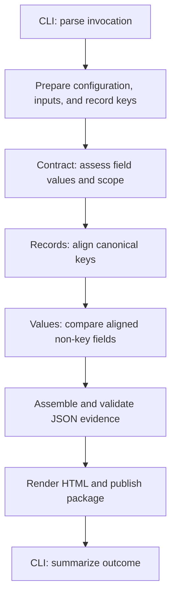

# Architecture of `adviso-compare`

This guide describes the current implementation for developers maintaining the
tool. It explains responsibilities and boundaries rather than defining product
behaviour. The [specification](SPECIFICATION.md) and packaged
[schemas](../src/adviso_compare/schemas/) remain the normative sources; the
[user guide](USER_GUIDE.md) explains the comparison concepts and terminology.
For setup, commands, and the development workflow, see
[Contributing](../CONTRIBUTING.md).

## Contents

- [Execution flow](#execution-flow)
- [Module responsibilities](#module-responsibilities)
- [Data representations](#data-representations)
- [Validation boundaries](#validation-boundaries)
- [Evidence assembly and publication](#evidence-assembly-and-publication)
- [Errors and determinism](#errors-and-determinism)
- [Packaging](#packaging)
- [Where to make a change](#where-to-make-a-change)

## Execution flow

The installed command enters `cli.main`. The CLI parses arguments, constructs a
`ComparisonInvocation`, calls the application, and translates its outcome or
exception into console output and an exit code. Comparison logic lives outside
the CLI.

The following diagram shows execution order, rather than module imports:

[`application.py`](../src/adviso_compare/application.py) coordinates this flow
through `prepare_comparison` and `execute_comparison`:

1. A supplied configuration is loaded and validated before either dataset is
   opened. Without one, both datasets are parsed before automatic configuration
   is generated.
2. Each dataset becomes a `RecordModel`. Key fields are translated and checked
   here, before the three comparison phases. An unusable or duplicate canonical
   key prevents safe alignment and raises an error.
3. Contract assessment translates in-scope fields on both sides, including
   records that will have no counterpart. It records assessment issues and
   exclusions, retaining translated values for subsequent comparison.
4. Record alignment matches canonical keys and records missing and extra
   records.
5. Value comparison considers in-scope non-key fields in matched records. It
   reuses contract assessments, classifying opportunities as matched,
   mismatched, or not assessable.
6. Evidence assembly combines these outcomes, validates the JSON pair against
   the original comparison context, and supplies immutable bytes to publication.

An incomplete comparison is a reportable outcome. Invalid configuration,
unreadable input, or unsafe record keys instead stop execution with an error.
The user guide explains the distinction between completion and agreement.

## Module responsibilities

All paths below are within `src/adviso_compare/`.

| Module | Responsibility |
| --- | --- |
| [`cli.py`](../src/adviso_compare/cli.py), [`invocation.py`](../src/adviso_compare/invocation.py) | Command parsing, invocation/outcome types, diagnostics, and exit codes. |
| [`application.py`](../src/adviso_compare/application.py) | Coordinates preparation, comparison phases, assembly, and publication. |
| [`inputs.py`](../src/adviso_compare/inputs.py) | Reads source bytes, captures provenance, parses CSV/TSV/JSON, and preserves native value categories and locations. |
| [`configuration.py`](../src/adviso_compare/configuration.py) | Loads restricted YAML, validates configuration, resolves defaults into domain objects, and validates saved configuration JSON. |
| [`processing.py`](../src/adviso_compare/processing.py) | Shared operation definitions and compatibility rules used by configuration validation and translation. |
| [`records.py`](../src/adviso_compare/records.py) | Generates automatic configuration and builds indexed records with validated canonical keys. |
| [`translation.py`](../src/adviso_compare/translation.py) | Applies source processing, null handling, mappings, type parsing, collection processing, and typed normalisation. |
| [`contract.py`](../src/adviso_compare/contract.py) | Assesses fields and scope, records causal issues and exclusions, and indexes assessments. |
| [`alignment.py`](../src/adviso_compare/alignment.py) | Aligns canonical record keys and identifies missing/extra records. |
| [`comparators.py`](../src/adviso_compare/comparators.py), [`values.py`](../src/adviso_compare/values.py) | Compare translated values and account for aligned value opportunities. |
| [`results.py`](../src/adviso_compare/results.py) | Constructs findings and summaries, orders and serializes JSON, validates evidence semantics, and owns `ComparisonEvidence`. |
| [`reporting.py`](../src/adviso_compare/reporting.py) | Renders HTML, publishes evidence safely, and inspects saved packages. |
| [`schemas/__init__.py`](../src/adviso_compare/schemas/__init__.py) | Loads explicitly supported schema resources from the installed package. |

These are ordinary modules with explicit function calls. Translation is shared
by key preparation and contract assessment. Results assembly consumes domain
outcomes; reporting consumes the validated evidence pair. `results.py` refers
to `PreparedComparison` through a type-checking import, avoiding a runtime
import cycle with the application coordinator.

Some responsibilities share a module: JSON assembly and semantic validation
are both in `results.py`; HTML, publication, and package inspection are all in
`reporting.py`. Their functions provide separate entry points for focused tests.

## Data representations

The implementation keeps source, canonical, and serialized representations
distinct so that comparison can use translated values while evidence retains
the relevant source facts.

| Representation | Purpose |
| --- | --- |
| `ParsedDataset`, `ParsedRecord`, `NativeValue` | Preserve parsed source values, native categories, numeric lexical forms, source locations, and input provenance. |
| `EffectiveConfiguration`, `FieldDefinition` | Supply resolved rules to comparison code. `EffectiveConfiguration.document` returns a copy of the selected configuration document. |
| `RecordModel`, `KeyedRecord`, `CanonicalKeyComponent` | Associate source records with typed canonical keys and provide a read-only key index. |
| `TranslatedValue`, `CanonicalValue`, `TranslationIssue` | Represent a field's source-to-canonical outcome and any attributable failure. Untyped preserved values retain their native representation. |
| `ContractResult`, `RecordsResult`, `ValuesResult` | Carry phase outcomes independently of JSON field layout and HTML presentation. |
| `ComparisonEvidence` | Holds the exact validated results and configuration byte streams. Parsed document access returns fresh mutable views. |
| `ComparisonOutcome` | Gives the CLI completion status, published directory, and finding counts. |

Most domain objects are frozen dataclasses, with tuples and read-only mappings
where appropriate. JSON dictionaries are used at document boundaries.

The configuration has two complementary representations. Domain fields have
defaults resolved for execution, while the saved document preserves the
selected configuration, including omitted optional properties. Saving does not
expand all defaults into JSON. This distinction matters when changing default
resolution or serialization: the document and executable interpretation must
continue to agree.

## Validation boundaries

Validation is layered because JSON Schema cannot express every comparison or
cross-file invariant.

| Boundary | Checks and available context |
| --- | --- |
| Configuration loading | Restricted YAML syntax, supported schema version, packaged configuration schema, and semantic rules such as field references and operation compatibility. |
| Input parsing and key preparation | Source format, encoding, native values, record shape, and usable unique canonical keys. |
| Contract assessment and value comparison | Per-field validity and comparability; attributable failures become assessment issues rather than generic parser errors. |
| `results.validate_result` | Results schema, exact configuration digest, saved configuration validity, supported schema combination, and cross-document semantics. Comparison context, when supplied, enables additional checks against inputs and phase outcomes. |
| `reporting.validate_evidence_package` | Fixed package membership, regular files, strict JSON parsing, and the validations available from the saved JSON pair. |

The dataset JSON decoder preserves native categories and numeric lexical
information for comparison. The separate `results.parse_evidence_json` decoder
reads evidence documents as JSON objects and rejects duplicate members,
non-finite numbers, and invalid encoding. Use the decoder appropriate to the
boundary rather than substituting a permissive `json.loads` call.

Both JSON documents declare their own `schema_version`. Schema resources are
selected locally by family and version; validation does not fetch schema IDs
from the network. The results schema does not embed the configuration schema.
`results.SUPPORTED_SCHEMA_COMBINATIONS` explicitly declares supported pairs,
and semantic validation checks their relationship.

Saved-package validation cannot reproduce the comparison without source
inputs. It also does not authenticate HTML content: the report is checked as a
required regular member, while the JSON pair supplies the validated evidence.

## Evidence assembly and publication

`results.assemble_result` converts domain outcomes into ordered findings,
counts, provenance, and run metadata. It serializes the configuration once and
records the SHA-256 digest of those exact bytes in the results document. The
pair is validated with comparison context before `ComparisonEvidence` is
created. Reserializing configuration later would risk breaking that byte link.

`reporting.render_html_report` renders the results and configuration documents
from that validated pair. It does not reread the original YAML or source
datasets. Presentation choices remain in the renderer; the JSON evidence
defines the facts displayed.

`reporting.publish_evidence_package` renders HTML before preparing output,
writes all three members into a private staging directory inside the output
parent, and publishes the completed directory through an exclusive rename.
The final name comes from the run timestamp and identifier. Publication refuses
an existing destination and cleans up its own staging area on failure.

The exclusive rename uses platform-specific filesystem operations. Unsupported
safe publication produces an output error rather than a replacement-based
fallback. POSIX directory and file modes restrict access to newly created
evidence. These details belong in publication code, not comparison phases.

## Errors and determinism

Boundary exceptions carry structured diagnostics: `ConfigurationError`,
`InputError`, `RecordKeyError`, and `OutputError`. `ResultValidationError`
reports invalid assembled or saved evidence. Translation failures attributable
to a field use `TranslationIssue` within a result object.

Exception objects remain mutable so Python can attach traceback and chaining
information, including during context-manager cleanup. Frozen domain data and
mutable exceptions serve different purposes.

The CLI maps expected input/configuration/output errors to exit code 2 and
unexpected errors to a generic diagnostic with exit code 3. A complete run
returns 0; an incomplete run returns 1. It does not expose an unexpected
traceback through normal command output.

Explicit sorting controls record, field, finding, and document order. Numeric
and datetime processing preserve the precision needed for comparison rather
than relying on binary floating-point approximations. Input hashes refer to
original bytes, and recorded input provenance uses basenames rather than
absolute paths. Findings can still contain sensitive source values; output
protection remains relevant.

Deterministic comparison does not mean identical bytes for repeated runs:
run identifiers and completion timestamps intentionally vary. Assembly accepts
controlled run metadata for repeatable tests.

## Packaging

[`pyproject.toml`](../pyproject.toml) defines a single installable distribution
with a `src/` layout and the `adviso-compare` console entry point. Runtime
dependencies are PyYAML and jsonschema with its configured format support;
development/build dependencies are declared separately.

Schemas are package resources loaded through `importlib.resources`. The user
guide and runnable examples are installed under `share/doc/adviso-compare`.
Developer guides are maintained in the repository. Git-derived version
information is generated by `setuptools-scm`; `_version.py` is generated output.

The [distribution test](../tests/test_distribution.py) builds both archives
and runs the same installed-command scenarios after fresh wheel and
source-archive installations. Each installation resolves its own dependencies
and runs outside the checkout. The
[CI workflow](../../../.github/workflows/adviso-compare-ci.yml) exercises the
supported Python/OS matrix; its scope and merge settings are explained in the
[contribution guide](../CONTRIBUTING.md#continuous-integration).

## Where to make a change

Start by checking the relevant normative text and existing tests. This table
locates responsibilities; it does not authorize a behavioural or schema change.

| Change | Implementation and existing tests |
| --- | --- |
| Input decoding, native categories, or source locations | `inputs.py`; [input tests](../tests/test_inputs.py). |
| Configuration syntax, defaults, or compatibility rules | Configuration schema, `configuration.py`, `processing.py`; [configuration](../tests/test_configuration.py) and [schema tests](../tests/test_schemas.py). |
| Automatic configuration or canonical keys | `records.py`, shared translation; [record tests](../tests/test_records.py). |
| Translation operations or logical types | `processing.py`, `translation.py`, configuration validation; [translation](../tests/test_translation.py) and configuration tests. |
| Contract assessment or exclusions | `contract.py`; [contract tests](../tests/test_contract.py). |
| Record matching | `alignment.py`; [alignment tests](../tests/test_alignment.py). |
| Equality, tolerance, collections, or opportunity counts | `comparators.py`, `values.py`; [value tests](../tests/test_values.py). |
| Finding content, JSON layout, or evidence linkage | `results.py`, relevant schemas; [results](../tests/test_results.py) and schema tests. |
| HTML presentation, saved-package inspection, or publication | Separate functions in `reporting.py`; [reporting tests](../tests/test_reporting.py). |
| Command behaviour or boundary errors | `cli.py`, `invocation.py`, `application.py`; [CLI tests](../tests/test_cli.py). |
| Installed resources or packaging | `pyproject.toml`; distribution tests. |
| Published examples and user instructions | `docs/USER_GUIDE.md`, `docs/examples/`; [documentation tests](../tests/test_documentation.py) and distribution tests. |

Cross-cutting changes often need tests at more than one boundary. For example,
a new configuration operation affects schema validation, resolved rules,
translation, and recorded evidence. Existing tests and the
[test conventions](../tests/README.md) provide the starting point.
